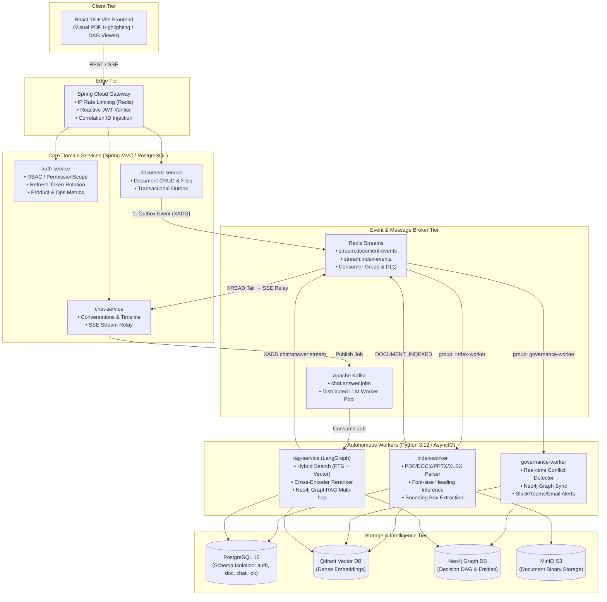

# Org-Decision-History (ODH)
> **엔터프라이즈 의사결정 맥락 추적 및 실시간 정책 거버넌스 RAG 플랫폼**  
> *Enterprise Decision Lineage, Automated Policy Conflict Detection & Visual-Grounded GraphRAG*

[](https://openjdk.org/)
[](https://spring.io/projects/spring-boot)
[](https://www.python.org/)
[](https://langchain-ai.github.io/langgraph/)
[](https://kafka.apache.org/)
[](https://neo4j.com/)
[](https://qdrant.tech/)
[](https://www.postgresql.org/)
[](https://www.docker.com/)

---

## 📌 1. 프로젝트 개요 (Problem Statement & Value)

### "왜 기존 사내 문서 검색(Enterprise Search)으로는 부족한가?"

현대 기업 환경에서 조직의 지식은 Confluence, Notion, 사내 드라이브에 흩어져 있습니다. 하지만 기존의 범용 사내 검색 및 단순 키워드/벡터 RAG는 세 가지 치명적인 한계를 가집니다.

1. **의사결정 맥락(Decision Context & Lineage)의 증발**:
   - "이 아키텍처는 왜 채택되었는가?", "작년에 검토하다 탈락한 대안(Alternative)은 무엇인가?"에 대해 문서는 '최종 결정'만 기록할 뿐, 의사결정 과정의 맥락을 보존하지 못해 담당자 퇴사나 조직 개편 시 암묵지가 완전히 사라집니다.
2. **소리 없는 규정 상충 (Silent Policy Inconsistency)**:
   - 조직 규모가 커질수록 신규 팀의 결정이나 새로운 정책 문서가 과거의 보안 규정, 타 부서 가이드라인과 정면으로 충돌하는 일이 발생합니다. 사고가 터지기 전까지는 누구도 충돌을 인지하지 못합니다.
3. **RAG 환각(Hallucination)과 출처 불신**:
   - AI가 답변을 생성해도 "이 답변이 문서 몇 페이지, 어느 문장을 근거로 작성되었는가?"를 시각적으로 즉시 검증할 수 없다면 사내 의사결정권자는 AI 답변을 신뢰할 수 없습니다.

### 💡 솔루션 (Solution)
**Org-Decision-History(ODH)**는 단순한 질의응답 챗봇을 넘어, **"의사결정 히스토리 추적 + 실시간 정책 상충 자동 감지 + PDF 시각적 바운딩 박스 검증"**을 결합한 엔터프라이즈급 지식 거버넌스 플랫폼입니다.

---

## 🏗️ 2. 시스템 아키텍처 (System Architecture)

본 시스템은 **Spring 생태계(API 게이트웨이 및 핵심 비즈니스 도메인)**와 **Python 비동기 워커 생태계(문서 파싱, Qdrant 벡터 검색, LangGraph 파이프라인, Neo4j GraphRAG)**가 분산 메시지 브로커(Kafka, Redis Streams)를 통해 결합된 마이크로서비스 아키텍처(MSA)입니다.



서비스별 역할, 요청 흐름(인증 · 문서 등록 → 색인 → 상충 감지 · 질문 → 답변 스트리밍 · 토큰 회전), 답변 파이프라인과 신뢰성 장치는 [**아키텍처 및 요청 흐름**](docs/아키텍처_및_요청흐름.md) 문서에 시퀀스 다이어그램과 함께 정리했습니다.

---

## ⚡ 3. 핵심 엔지니어링 챌린지 및 해결책 (Deep Dive)

### ① Transactional Outbox 패턴과 이원화된 이벤트 브로커 설계
- **문제**: 문서 업로드 시 RDB 트랜잭션과 외부 메시지 브로커 발행 간의 원자성(Atomicity)이 깨져, DB는 저장되었으나 색인 이벤트가 유실되는 Dual-Write 불일치 위험 존재.
- **해결책**:
  - `document-service`에 **Transactional Outbox 패턴**을 구축하여 문서 메타데이터 저장과 아웃박스 이벤트 INSERT를 단일 RDB 트랜잭션으로 묶음.
  - 별도 퍼블리셔 스레드가 아웃박스 테이블을 폴링하여 Redis Streams로 안전하게 이벤트를 전달(`XADD`).
  - **브로커 이원화 전략**:
    - **Redis Streams**: 순차 처리, XAUTOCLAIM(장애 워커 작업 회수), 가벼운 상태 전이가 필요한 색인·상충 감지 파이프라인에 사용.
    - **Apache Kafka**: 유휴 시간이 길고 컴퓨팅 자원을 대량 소모하는 LLM 답변 생성 워커 풀의 부하 분산 큐로 분리하여 상호 간섭 차단.

### ② 환각(Hallucination) 억제: 2차 재순위화 + PDF 시각적 바운딩 박스
- **문제**: 범용 벡터 검색의 상위 청크가 실제 질문과 미묘하게 어긋나 환각을 유발하고, 텍스트만 나열된 출처는 사용자가 신뢰하기 어려움.
- **해결책**:
  - **하이브리드 검색 & Reranking**: PostgreSQL 전문검색(`ts_rank`)과 Qdrant(코사인 벡터) 결과를 RRF로 병합해 상위 20개 후보를 만든 뒤, `ms-marco-MultiBERT-L-12` Cross-Encoder 모델을 통해 의미적 유사도를 2차 정밀 재평가(Top-5 선정).
  - **근거가 없으면 답하지 않음**: 재순위화 후 근거가 없거나 요청자가 볼 수 있는 출처가 없으면 생성 단계로 가지 않고 `NO_EVIDENCE`로 종료.
  - **PDF 시각적 검증 (Visual Grounding)**:
    - `pdfplumber` 기반 파서가 문서를 색인할 때 텍스트뿐만 아니라 줄 단위 좌표(페이지·x·y·w·h, 0~1 정규화)를 추출하여 PostgreSQL 청크 테이블에 보존. 글자 크기로 헤딩을 추정해 PDF도 절 단위로 인용.
    - 프론트엔드 출처 패널에서 클릭 시 원본 PDF를 모달로 띄우고, 답변의 근거가 된 청크가 차지한 줄들을 하이라이트.

### ③ $O(N^2)$ LLM 비용 폭증을 방어한 정책 상충(Conflict) 자동 감지 엔진
- **문제**: 새 정책 문서 등록 시 기존 N개 문서와 전수 대조할 경우, $N \times (N-1) / 2$ 회의 LLM 추론 비용과 지연 시간이 기하급수적으로 폭증.
- **해결책**:
  - **조항 단위 후보 게이팅**:
    1. **핵심 조항 추출**: 색인 완료 이벤트 수신 시, LLM이 새 문서에서 규정·결정에 해당하는 핵심 조항을 뽑는다.
    2. **벡터 최근접 후보**: 조항마다 같은 조직 안에서 Qdrant 최근접 청크 5개만 비교 후보로 삼는다. LLM 호출이 문서 수의 제곱이 아니라 `조항 수 × 5` 이하로 묶인다.
    3. **LLM 모순 판정**: 후보 쌍에 대해서만 Groq(GPT-OSS 120B, 한도 초과 시 20B)를 호출해 모순 여부, 심각도(0.0~1.0), 상충 조항을 추출하고 심각도 0.70 이상만 기록.
  - **자동 버전 수명주기 관리**: 문서를 개정(Revision)하여 새 판본이 등록되면, 과거 판본을 기준으로 열려 있던 기존 상충 건을 감지하여 자동으로 `SUPERSEDED` 상태로 전환 및 종료.
  - **다채널 알림 라우팅**: 상충 감지 시 Slack Block Kit, Teams Card, 그리고 해당 문서의 **실제 작성자(Author) 개인 이메일**로 상충 보고서 자동 발송.

### ④ Neo4j 기반 Decision GraphRAG (의사결정 관계망)
- **문제**: 단순 문서 청크는 "A안 대신 B안을 선택한 배경"이나 "B안 결정이 인프라팀에 미치는 영향" 같은 인과적 네트워크 관계를 표현하지 못함.
- **해결책**:
  - 문서 내에서 결정(`Decision`), 검토한 대안(`Alternative`), 결정 근거(`Rationale`), 영향받는 시스템(`Impact`) 엔티티와 관계를 추출하여 Neo4j 지식 그래프로 동기화.
  - LangGraph 워커가 질의 시 벡터 검색 결과와 함께 Neo4j의 1-hop / 2-hop 서브그래프를 결합하여 "과거에 왜 이 결정이 내려졌는지" 맥락 전체를 프롬프트에 주입.

### ⑤ 엄격한 마이크로서비스 데이터 계약(Contracts) 및 Golden Test
- **문제**: 다중 언어(Java/Spring + Python) 분산 환경에서 모델 파라미터나 청킹 규칙이 어긋나면 런타임에 조용히 검색 품질이 깨짐.
- **해결책**:
  - `contracts/` 디렉터리에 JSON Schema(이벤트 포맷) 및 OpenAPI 스펙을 중앙 집중화.
  - **Golden Snapshot Tests**: 파싱·청킹·임베딩 결과의 기대값을 스냅샷으로 고정하여, 워커 리팩토링이나 라이브러리 업데이트로 검색 결과가 조용히 바뀌면 CI 단계에서 실패.
  - **OpenAPI 스냅샷**: 각 Spring 서비스의 실제 API 스펙을 코드에서 뽑아 커밋하고, 어긋나면 CI가 실패해 계약 변경이 리뷰를 건너뛰지 못하게 함.

---

## 📊 4. 제품 및 운영 지표 (Engineering Metrics)

본 프로젝트는 운영 가용성뿐만 아니라 **"AI 플랫폼의 실질적 가치와 신뢰도"**를 측정하는 관리자 전용 제품 지표 파이프라인을 내장하고 있습니다.

| 지표 항목 | 정의 | 목표치 | 실측 / 달성 메커니즘 |
|---|---|:---:|---|
| **출처 포함 답변율** | 전체 답변 중 출처(Source)가 1건 이상 첨부된 비율 | **85%+** | 근거가 없으면 답하지 않는 `NO_EVIDENCE` 경로 |
| **출처 검증 가능 비율** | 인용된 출처 중 다운로드 가능한 원본 파일이 존재하는 비율 | **95%+** | 판본 승계(Version Fallback) 로직으로 원본 유실 방지 |
| **응답 지연 시간** | 워커가 job을 받은 뒤 답변 완료까지(평균·p95) | **< 5초** | Groq 추론 + Kafka 비동기 파이프라인 |
| **권한 차단(Denied)** | 인가되지 않은 타 조직/타 부서 접근을 차단한 건수(감사 로그) | — | `PermissionScope` 기반 DB 쿼리 레벨 차단 |
| **유용 평가 비율** | 사용자 답변 피드백 중 HELPFUL 비율 | **80%+** | 피드백 드릴다운(부정 평가된 실제 질문/출처 분석) 지원 |

---

## 🛠️ 5. 기술 스택 (Tech Stack)

| 계층 | 기술 스택 | 적용 목적 및 특징 |
|---|---|---|
| **Edge / Gateway** | Spring Cloud Gateway, WebFlux | 반응형 리버스 프록시, IP 기반 RedisRateLimiter, JWT 검증 |
| **Backend Services** | Java 21, Spring Boot 3.5, Spring Data JPA | 도메인 비즈니스 로직, 아웃박스 이벤트 발행, RBAC 권한 관리 |
| **AI / Workers** | Python 3.12, FastAPI, LangGraph, aiokafka | 분산 비동기 처리, RAG 워크플로 오케스트레이션, 문서 파싱 |
| **Databases** | PostgreSQL 16, Neo4j 5.26, Qdrant 1.12 | RDB(도메인 데이터) + Graph DB(의사결정망) + Vector DB(임베딩) |
| **Message Broker** | Apache Kafka 3.8, Redis 7.4 (Streams) | 실시간 잡 큐(LLM 분산) 및 이벤트 스트리밍(XAUTOCLAIM/DLQ) |
| **Object Storage** | MinIO S3 | PDF, DOCX, PPTX, XLSX, MD, TXT 원본 파일 저장 (서명 URL 다운로드) |
| **Frontend** | React 18, Vite, TypeScript | 지식 그래프 시각화(xyflow), PDF 좌표 하이라이트 모달 |
| **DevOps / CI** | Docker Compose, GitHub Actions | 15개 서비스 리소스 리밋 격리, Bake 기반 다중 이미지 캐시 빌드 |

---

## 🚀 6. 빠른 실행 가이드 (Quick Start)

### 사전 요구사항
- Docker & Docker Compose v2.20+
- 최소 권장 사양: 4 Core CPU, 12GB RAM 이상 (전체 컨테이너 동시 구동 시)

```bash
# 1. 저장소 클론
git clone https://github.com/bbbbb0413/org-decision-history.git
cd org-decision-history

# 2. 환경변수 템플릿 복사
cp .env.example .env
# 필요 시 .env 파일에 GEMINI_API_KEY 및 GROQ_API_KEY 입력 (미입력 시 로컬 해시 임베딩/근거 발췌 모드로 자동 폴백)

# 3. 전체 서비스 및 저장소 원클릭 기동 (15개 컨테이너)
docker compose --profile app up -d --wait

# 4. 접속
# • 웹 UI: http://localhost:5173
# • API Gateway: http://localhost:8080
# • 기본 테스트 관리자 계정: admin@company.com / password123

# 5. (선택) 데모 데이터 — 원본 파일이 붙은 문서 4건과 질문·평가
python3 deploy/demo-seed/seed_demo_data.py
```

데모 데이터의 내용과 원리는 [`deploy/demo-seed/README.md`](deploy/demo-seed/README.md)에 있습니다.

---

## 📄 7. License

[MIT License](LICENSE) — Copyright © 2026 Kang Seungwon.

본 프로젝트는 개인 포트폴리오 및 기술 연구 목적으로 제작·공개되었습니다.
