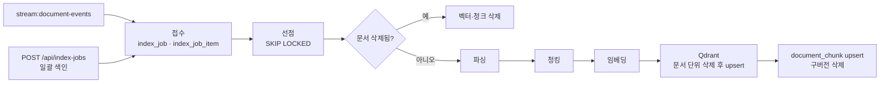

# 색인 계약 (index-worker)

index-worker(`server/python/index-worker`)가 문서를 검색 단위로 만드는 규칙이다. 코드가 **지금 실제로 하는 일**을 적었고, [골든 스냅샷](golden/README.md)이 이 규칙을 테스트로 고정한다.

| 항목 | 원천 코드 (`server/python/`) |
|---|---|
| 원문 선택·파이프라인 | `index-worker/app/pipeline.py`, `documents.py` |
| 파싱 | `index-worker/app/parse.py` |
| 청킹·헤더·태그 | `index-worker/app/chunk.py` |
| 토큰 추정 | `shared/history_shared/text.py` |
| 임베딩 | `shared/history_shared/embeddings.py` |
| 벡터·전문검색 저장 | `shared/history_shared/vector.py`, `index-worker/app/chunks_store.py` |
| 이벤트·작업 관리 | `index-worker/app/consumer.py`, `jobs.py`, `runner.py` |
| 스키마 | `index-worker/migrations/V1__index_schema.sql` |

## 1. 처리 흐름



단계 이름(`index_stage`)과 실패 시 재시도 여부:

| 단계 | 실패 상황 | retryable |
|---|---|---|
| `PARSE` | 문서 행이 없음 (`문서를 찾을 수 없습니다`) | false |
| `PARSE` | 파서가 던진 `ParseException` | 파서가 정한 값(현재 모두 false) |
| `PARSE` | 그 밖의 예외(객체 저장소 읽기 실패 등) | true |
| `CHUNK` | 청크가 0개 (`본문이 비어 있어 색인할 내용이 없습니다`) | false |
| `CHUNK` | 그 밖의 예외 | true |
| `EMBED` | `EmbeddingException` | 예외가 정한 값 |
| `EMBED` | 그 밖의 예외 | true |
| `VECTOR_UPSERT` | Qdrant 삭제·저장 실패(삭제 문서 처리 포함) | true |
| `KEYWORD_INDEX` | `document_chunk` 저장·구버전 삭제 실패 | true |

## 2. 원문 선택

색인 대상은 `document.document`의 현재 버전이다. 원본 파일은 `document.document_file`에서 **현재 판 이하에서 가장 최근에 올라온 것**을 쓴다(`version <= current_version ORDER BY version DESC LIMIT 1`). 본문만 고쳐 판이 올라가도 원본과 PDF 좌표가 유지되고, 원본을 다시 올리면 그 판의 행이 우선한다.

- 원본 파일이 있으면 객체 저장소에서 읽어 `original_filename`의 확장자로 파싱한다. `mime_type`은 보지 않는다.
- 없으면 `document.content`를 UTF-8 바이트로 바꿔 파일명 `content.md`, 즉 마크다운으로 파싱한다.
- `deleted_at`이 있으면 파싱하지 않고 색인에서 지운다. 이벤트 종류가 아니라 **읽은 시점의 삭제 여부**로 판단한다.
- 청크 헤더에는 `title`, `authored_at`, `project_name`을 쓴다.

## 3. 파싱

확장자는 파일명의 마지막 `.` 뒤를 소문자로 바꾼 값이다. `.`이 없으면 빈 문자열이다.

| 확장자 | 본문 `text` | 헤딩 |
|---|---|---|
| `md` | UTF-8 디코딩 결과 그대로 | 정규식 `^(#{1,6})\s+(.+)$`(MULTILINE). `level` = `#` 개수, `title` = 2번 그룹의 앞뒤 공백 제거, `offset` = 매치 시작 위치 |
| `txt` | UTF-8 디코딩 결과 그대로 | 없음 |
| `pdf` | pdfplumber `extract_text_lines` 를 줄 단위로 이어 붙인 평문(쪽 끝에 `\n`) | **글자 크기로 추정한다.** 본문 크기(글자 수 기준 최빈값)의 1.15배 이상이고 120자 이하인 줄이 헤딩이다. 큰 글씨가 상위 `level`(최대 6). **확신이 없으면 하나도 만들지 않는다** — 본문 크기가 전체 글자의 과반이 아니거나 줄이 3개 미만이면 추정을 포기한다 |
| `docx` | 본문 문단과 **표**를 놓인 순서대로. 비어 있거나 공백뿐인 문단은 `\n`, 나머지는 `문단 텍스트 + \n`. 표는 §3.1의 파이프 행 | 문단 스타일 **ID**가 `(?i)heading\s*([1-6])`에 걸리면 헤딩. `offset`은 그 문단을 붙이기 직전의 `text` 길이, `title`은 앞뒤 공백 제거 |
| `pptx` | 슬라이드마다 제목 → 나머지 도형의 문단·표를 순서대로. 묶은 도형은 펼친다. 표는 §3.1의 파이프 행 | 슬라이드마다 **제목 개체 틀**이 level 1 헤딩. 제목이 없으면 `슬라이드 N`(지어낸 이름이라 본문에는 적지 않고 절 경로에만 쓴다) |
| `xlsx` | 시트 이름 줄 + 시트의 각 행을 §3.1의 파이프 행으로. 전부 빈 행은 버린다 | 시트 이름이 level 1 헤딩 |
| 그 외 | — | 실패: `지원하지 않는 파일 형식입니다: {확장자}` (retryable=false) |

- **PDF 헤딩은 추정이라 보장이 아니다.** 서식이 균일한 문서(크기 변화가 없는 PDF)는 헤딩 없이 종전처럼 한 덩어리가 된다. 잘못 자르면 인용이 "이 문서의 어디"를 틀리게 가리키므로, 애매할 때 자르지 않는 쪽으로 기울였다.
- PDF 실패: 암호화면 `암호화된 파일이라 본문을 추출할 수 없습니다`, 그 밖에는 `PDF 를 읽을 수 없습니다: {원인}`. 모두 retryable=false.
- docx·pptx·xlsx 실패: `{형식} 를 읽을 수 없습니다: {원인}`, retryable=false.
- 마크다운 정규식은 코드 펜스를 모른다. 펜스 안의 `# ...` 줄도 헤딩이다.
- `\s+`는 줄바꿈도 포함하므로 `#` 한 글자만 있는 줄 다음 줄이 제목이 되는 경우가 있다(`#\n제목` → level 1, title `제목`).
- docx의 머리글·바닥글, 각주, 텍스트 상자는 본문에 들어가지 않는다. **표는 들어간다**(§3.1).
- pptx의 발표자 노트, 차트 데이터, SmartArt 는 읽지 않는다. xlsx 의 차트·이미지·주석도 읽지 않는다.
- 상한: PDF 500쪽, pptx 300장을 넘으면 **거절**한다(`{쪽|장} 수가 너무 많습니다`, retryable=false). xlsx 는 2,000행을 넘으면(시트 합계) 거절하지 않고 앞부분만 읽은 뒤 마지막에 `〈행이 너무 많아 이후 내용은 색인하지 않았습니다〉` 줄을 남긴다 — 쪽·장 수가 많은 문서는 이 시스템이 다루는 종류가 아니지만, 행이 많은 스프레드시트는 정당한 문서일 수 있어 거절하면 지식으로 아예 들어오지 못한다. 셀은 500자까지만 읽는다. **xlsx 행·셀 상한은 [`limits.json`](limits.json) 이 원본이다** — 가져오기(document-service `DocumentMetadataExtractor`)와 색인(index-worker `parse.py`)이 같은 범위를 봐야 하고, 양쪽 테스트가 이 파일과 대조한다.
- xlsx 수식은 **엑셀이 마지막에 저장한 계산 결과**를 쓴다(`data_only=True`). 계산된 적이 없는 칸은 빈 칸이 된다 — 수식 문자열(`=SUM(B2:B9)`)을 색인하면 검색이 오염된다.

### 3.1 표

표는 마크다운 파이프 행으로 적는다.

```
| 셀 | 셀 | 셀 |
```

- 셀 안의 `\r`·`\n`은 공백 하나로, `|`는 `\|`로 바꾼다. 남겨 두면 한 행이 여러 줄로 갈리거나 열 수가 어긋난다.
- 셀은 앞뒤 공백을 지우고 500자에서 자른다. 오른쪽의 빈 열은 버린다(엑셀은 쓰지 않은 열도 행에 담아 준다).
- 모든 셀이 빈 행은 적지 않는다.
- 머리글 구분선(`|---|`)은 **붙이지 않는다.** 첫 행이 머리글인지 파일에서 알 수 없고, 아니라면 데이터 한 줄을 머리글로 읽게 만든다.
- 가로로 병합된 칸은 한 번만 적는다(docx).

새 표현을 만들지 않은 이유는 청커가 이미 이 모양을 아는 것이다 — §4.2에서 `|...|` 줄은 길이 분할에서 끊지 않으므로 표 한 행이 두 청크로 갈리지 않는다.

## 4. 청킹

상수: **목표 400 · 최대 700 · 겹침 60 토큰**. 토큰은 §6의 추정값이다.

### 4.1 절 나누기

1. 헤딩이 없으면 문서 전체가 경로 `""`인 절 하나다.
2. 헤딩이 있으면:
   - 첫 헤딩 `offset`이 0보다 크면 `[0, 첫 헤딩)`을 경로 `""`인 도입부 절로 둔다.
   - 각 헤딩은 `[헤딩 offset, 다음 헤딩 offset 또는 끝)`을 절 본문으로 갖는다. **헤딩 줄 자체가 본문에 포함된다.**
   - 경로: 수준 1~6 슬롯에 현재 헤딩 제목을 넣고 더 깊은 슬롯을 비운 뒤, 채워진 슬롯을 수준 순서로 ` > `로 잇는다. 수준을 건너뛰어도 그대로 잇는다(`# A` 다음 `### B` → `A > B`).

### 4.2 길이 분할

절 본문 전체의 추정 토큰이 700 이하이면 나누지 않는다. 700을 넘으면 줄 단위로 나눈다.

```
lines = body.split("\n")            # 끝의 빈 문자열도 남긴다
pieces, buffer, bufferTokens, insideCode = [], [], 0, false
for line in lines:
    wasInsideCode = insideCode
    if line 이 "```" 로 시작:  insideCode = not insideCode
    unbreakable = wasInsideCode or insideCode or line 이 ^\s*\|.*\|\s*$ 에 완전 일치
    lineTokens = estimate(line)
    if not unbreakable and bufferTokens + lineTokens > 400 and buffer 가 비어 있지 않음:
        pieces.append(join(buffer, "\n"))
        buffer = tail(buffer)                        # 겹침
        bufferTokens = estimate(join(buffer, "\n"))  # 줄별 합이 아니라 이어 붙인 문자열로 다시 센다
    buffer.append(line)
    bufferTokens += lineTokens
if buffer 가 비어 있지 않음: pieces.append(join(buffer, "\n"))

tail(lines): 뒤에서부터 줄을 앞에 끼워 넣으며, 누적 토큰이 60 이상이 되면 멈춘다(60을 넘기게 한 줄까지 포함)
```

- 코드 블록 안과 여닫는 펜스 줄, 표 행에서는 끊지 않는다. 그래서 **조각이 700토큰을 넘을 수 있다.**
- `bufferTokens`는 줄마다 올림한 값의 합이다. 줄바꿈 문자는 세지 않는다. 겹침 직후에만 이어 붙인 문자열로 다시 센다.

### 4.3 청크 만들기

조각마다 순서대로:

1. 조각이 비어 있으면(`isBlank`) 건너뛴다.
2. `content = header(절 경로) + "\n\n" + strip(조각)`
3. `chunk_tag`는 **앞뒤 공백을 지우기 전 조각**(헤더 제외, 겹침 줄 포함)에 §5 규칙을 적용한 값이다.
4. `token_count = estimate(content)`. 헤더를 포함한다.
5. `chunk_no`는 문서 전체에서 0부터 1씩 증가한다.

모든 조각이 비었는데 원문 `text`가 비어 있지 않으면 `header("") + "\n\n" + strip(text)`, `BACKGROUND`로 청크 하나를 만든다(절이 원문 전체를 덮으므로 사실상 일어나지 않는다). 청크가 0개면 파이프라인이 `CHUNK` 단계 실패로 처리한다.

### 4.4 청크 헤더

```
[문서] {title}[ | 작성일 {yyyy-MM-dd}][ | 프로젝트 {project_name}][ | 절 {section_path}]
```

- 작성일은 값이 있을 때, 프로젝트와 절은 비어 있지 않을 때만 붙인다. 값은 앞뒤 공백을 지우지 않고 그대로 넣는다.
- 헤더와 본문 사이는 빈 줄 하나(`\n\n`)다. **소비자가 이 형식에 의존한다.**
  - chat-service `TimelineService`: 정규식 `(?s)^\[문서].*?\n\n`으로 헤더를 떼어 결정 발췌를 만든다.
  - rag-service `generation/extractive.py`: `[문서]`로 시작하는 문장을 건너뛴다.
  - 제목에 빈 줄이 들어가면 두 소비자 모두 헤더 일부를 본문으로 본다.

## 5. 태그

조각에서 아래 정규식을 순서대로 **부분 일치**로 찾아 처음 걸린 태그를 쓴다. 대소문자 무시는 ASCII에만 적용된다.

| 순서 | 태그 | 정규식 |
|---|---|---|
| 1 | `DECISION` | `결정\|채택\|확정\|승인\|선정\|합의\|reject\|approve\|decide` |
| 2 | `ACTION_ITEM` | `액션\|todo\|담당자\|기한\|follow[- ]?up\|action item` |
| 3 | `DISCUSSION` | `논의\|검토\|의견\|대안\|비교\|제안\|discuss\|review` |
| 4 | `BACKGROUND` | 아무것도 걸리지 않을 때 |

부분 일치라 `미결정`도 `DECISION`, `approved`도 `DECISION`이다. 타임라인 발췌는 `chunk_tag = 'DECISION'`인 청크를 쓴다.

## 6. 토큰 추정

```
cjk   = UTF-16 코드 단위 중 U+AC00–U+D7A3(한글 음절), U+3130–U+318F(한글 자모), U+4E00–U+9FFF(한자)의 개수
other = 나머지 UTF-16 코드 단위 개수
estimate = ceil(cjk * 0.7 + other / 4.0)      # 빈 문자열은 0
```

**코드 포인트가 아니라 UTF-16 코드 단위로 센다.** 이모지 같은 BMP 밖 문자는 2개로 센다(`😀` → 2/4 → 1).

## 7. 문자열 처리 규칙

계약은 문자열을 Java `String` 의미로 정의한다(길이·공백·정규식). Python 기본 동작과 다른 곳을 아래처럼 구현하고, 골든 사례로 고정했다.

| 항목 | 계약 | Python 기본 | 구현 |
|---|---|---|---|
| 길이·offset | UTF-16 코드 단위 | 코드 포인트 | 토큰 추정은 `text.encode("utf-16-le")` 기준, offset은 변환해 비교 |
| `strip()`·`isBlank()` | `Character.isWhitespace` 기준. **NBSP(U+00A0), U+2007, U+202F는 공백이 아니다**. U+3000은 공백이다 | `str.strip()`은 NBSP도 지운다 | 공백 판정 함수를 계약대로 구현(`history_shared.text`) |
| 정규식 `\s` | ASCII 공백만 | 유니코드 공백 | `re.ASCII` |
| 정규식 `.`, `$` | `.`은 `\r`에서 멈추고, MULTILINE `$`는 `\r\n` 앞에서 맞는다. CRLF에서 헤딩 제목에 `\r`이 붙지 않는다 | `.`이 `\r`을 포함 | 제목을 strip하면 같아진다. 청크 본문의 `\r`은 그대로 둔다 |
| 대소문자 무시 | ASCII만 | 유니코드 | 태그 키워드가 ASCII라 결과는 같다 |
| 확장자 소문자 | 기본 로캘 `toLowerCase()` | `str.lower()` | ASCII 확장자면 같다 |
| 코드 펜스 판정 | 줄이 `` ``` ``로 시작 | — | `line.startswith("```")` |

## 8. point ID

Qdrant point ID는 문서·버전·청크 번호로 결정한다. 재색인하면 같은 ID를 덮어써 중복 벡터가 생기지 않는다.

```
seed    = "{document_id}:{version}:{chunk_no}"          # 10진수
digest  = SHA-256(seed 의 UTF-8 바이트)                  # 32바이트
pointId = UUID.nameUUIDFromBytes(digest)                 # = MD5(digest) 에 UUID 버전 3·variant 비트를 넣은 값
```

참조 구현(`history_shared.vector.point_id`):

```python
import hashlib, uuid

def point_id(document_id: int, version: int, chunk_no: int) -> uuid.UUID:
    digest = hashlib.sha256(f"{document_id}:{version}:{chunk_no}".encode()).digest()
    return uuid.UUID(bytes=hashlib.md5(digest).digest(), version=3)
```

## 9. scope_key

`team:{team_id}`(팀이 있을 때), 아니면 `org:{organization_id}`. 색인 시점의 문서 소속을 Qdrant payload와 `document_chunk.scope_key`에 같은 값으로 새긴다. rag-service는 사용자 권한에서 만든 scope_key 목록으로 두 색인을 거른다.

## 10. 임베딩

| 항목 | 값 |
|---|---|
| 모델 | `gemini-embedding-001` (`embedding.model`) |
| API | `POST {endpoint}/v1beta/models/{model}:batchEmbedContents?key={apiKey}` |
| 요청 항목 | `{"model": "models/{model}", "content": {"parts": [{"text": ...}]}, "taskType": ..., "outputDimensionality": 768}` |
| taskType | 문서 `RETRIEVAL_DOCUMENT`, 질의 `RETRIEVAL_QUERY` |
| 입력 | 청크 `content` 전체(헤더 포함) |
| 배치 | 20개 |
| 속도 제한 | 토큰 버킷 두 개. 요청 100/분(배치당 1), 토큰 30,000/분(배치의 추정 토큰 합). 버킷 크기 = 분당 한도, 부족하면 최대 5초씩 기다리며 다시 확인. 한도보다 큰 요청은 한도만큼만 기다린다 |
| 재시도 | 429·5xx만 최대 3회. `Retry-After`(초 또는 HTTP 날짜)를 우선하고, 없으면 1·2·4초. 소진 시 retryable=true |
| 그 밖의 HTTP 오류 | retryable=false |
| 응답 검증 | `embeddings` 개수가 요청 수와 다르면 retryable=false |

**대체 임베딩**: API 키가 비어 있으면 `local-hashing-ngram`을 쓴다. 파이프라인 확인용이며 의미 검색이 되지 않는다.

```
normalized = lower(text, Locale.ROOT) 에서 연속 \s 를 공백 하나로 바꾸고 strip
for 각 UTF-16 위치 i (i + 3 <= 길이):  gram = normalized[i:i+3]
    h = MD5(gram UTF-8) 앞 4바이트를 big-endian 부호 있는 int 로 읽은 값
    vector[floorMod(h, 768)] += 1
L2 정규화(노름이 0이면 그대로)
```

- 구현은 `history_shared.embeddings`다. 문서 색인·rag-service 질의·governance-worker 조항 임베딩이 모두 이 구현(대체 임베딩 포함)을 써서 벡터 공간이 어긋나지 않는다. 대체 임베딩 결과는 골든 `local-embeddings`로 고정한다.
- 모델이 바뀌면 벡터 공간이 달라지므로 전체를 재색인한다. payload `model_name`으로 구분할 수 있다.

## 11. 저장

### 11.1 Qdrant

- 컬렉션 `document_chunks`, 768차원, Cosine. 기동 시 **없다고 확인될 때만** 만든다(조회 오류는 그대로 올린다).
- 색인: `document_id` 필터로 **문서의 모든 point를 지운 뒤** 현재 버전 청크를 `wait=true`로 upsert한다. 구버전 point가 남지 않는다.
- 삭제 문서: 같은 필터로 지운다.
- payload: [`../qdrant-chunk-payload.schema.json`](../qdrant-chunk-payload.schema.json)

### 11.2 PostgreSQL `indexing.document_chunk`

- `(document_id, document_version, chunk_no)` 충돌 시 갱신하는 upsert. `search_vector = to_tsvector('simple', content)`, `vector_point_id` = §8 point ID.
- 저장과 같은 문서의 **다른 버전** 행 삭제를 한 트랜잭션으로 한다. 구버전과 신버전이 함께 검색되는 순간이 없다.
- 삭제 문서: 문서의 모든 행을 지운다.
- 벡터 저장이 끝난 뒤에 실행한다. 두 저장은 한 트랜잭션이 아니므로 중간 실패 시 재시도로 맞춘다.

## 12. 이벤트 소비와 작업 관리

### 12.1 스트림 소비

- 스트림 `stream:document-events`, 그룹 `index-worker`, 소비자 `index-worker-{호스트명}`. 항목 형식은 [`../events/document-events.schema.json`](../events/document-events.schema.json).
- 처리 성공(중복 포함) 시 ACK, 실패 시 ACK하지 않는다. 60초 넘게 ACK되지 않은 항목은 `XAUTOCLAIM`으로 가져와 다시 처리한다(죽은 소비자의 항목도 넘겨받는다).
- 전달 5회를 넘긴 항목과 계약을 어긴 항목은 `stream:document-events:dlq`로 옮기고 ACK한다. 운영 화면에서 조회·재처리·폐기한다.
- 트리거: `DOCUMENT_CREATED` → `DOCUMENT_UPLOAD`, `DOCUMENT_DELETED` → `DOCUMENT_DELETE`, 그 외(`DOCUMENT_UPDATED`) → `DOCUMENT_UPDATE`. 조직·팀 변경도 수정 이벤트로 오고, 그 재색인이 `scope_key` 를 갱신한다
- 멱등 키: `evt:{documentId}:{version}:{eventType}:{eventId}`. `eventId`(아웃박스 행 번호)는 선택 필드라 없으면 앞 네 부분만 쓴다. 같은 판에 원본을 다시 올려도 이벤트 ID 가 달라 재색인된다. 같은 키의 항목이 있으면 접수하지 않는다.
- 핸들러가 도는 동안 `claim_min_idle`의 1/3 간격으로 `XCLAIM JUSTID`로 유휴 시간을 되돌려, 오래 걸리는 처리를 다른 인스턴스가 가로채지 않는다(governance-worker 와 공용).

### 12.2 작업

- 이벤트 1건마다 `index_job` 1개(`total_count = pending_count = 1`)와 `index_job_item` 1개(`PENDING`, `next_attempt_at = now()`)를 만든다. `job_key`는 무작위 UUID. 항목 삽입이 충돌하면(동시 중복 접수) 작업까지 되돌린다.
- 일괄 색인(`POST /api/index-jobs`, body `{organizationId?, teamId?}`): 조건에 맞는 삭제되지 않은 문서를 id 순으로 한 작업에 담는다. 멱등 키 `bulk:{jobKey}:{documentId}:{version}`. 대상이 없으면 바로 `COMPLETED`. 응답 202 + 작업.
- 선점: `status = 'PENDING' AND retryable AND (next_attempt_at IS NULL OR next_attempt_at <= now())`를 `ORDER BY id LIMIT 1 FOR UPDATE SKIP LOCKED`로 1건. 1초 주기로 깨어나 최대 20건 연속 처리.
- 선점(`RUNNING`, `last_attempt_at = now()`)을 **짧은 트랜잭션으로 먼저 커밋**하고 작업 집계도 이때 갱신한다. 파이프라인은 트랜잭션 밖에서 돈다 — 임베딩 속도 제한을 기다리는 동안 행 잠금과 DB 연결을 붙잡지 않고, 진행 중 상태가 관리자 화면에 보인다.
- 처리하는 동안 10초마다 `heartbeat_at`을 쓴다. 이 신호가 60초 넘게 끊긴 `RUNNING`은 워커가 중단된 것으로 보고 한 번의 시도로 세어 `PENDING`(한도를 넘으면 `FAILED`)으로 되돌린다. 30초마다 확인한다. 종료 신호로 처리를 끊으면 재시도 횟수를 쓰지 않고 바로 `PENDING`으로 돌려놓는다.
- 성공 시 `COMPLETED`(stage·failure_reason 비움).
- 실패 시 `retry_count += 1`, `stage`, `failure_reason`(300자 초과 시 297자 + `...`, 메시지 없는 예외는 예외 클래스 이름), `retryable` 기록. retryable이고 `retry_count <= 3`이면 `PENDING` + 5초·1분·10분 뒤, 아니면 `FAILED`.
- 작업 집계는 항목 상태에서 다시 계산한다: `COMPLETED` 수, `FAILED` 수, `PENDING`+`RUNNING` 수. 대기 0이면 실패가 있을 때 `FAILED`, 없으면 `COMPLETED`(`finished_at = now()`), 아니면 `RUNNING`.

### 12.3 HTTP API와 공통 규약

| 메서드·경로 | 응답 |
|---|---|
| `GET /api/index-jobs?page=0&size=20` | `PageResponse<IndexJob>`(`content, page, size, totalElements, totalPages`), `requested_at` 내림차순 |
| `POST /api/index-jobs` | 202 `IndexJob`. `X-User-Id` 헤더 필수 |
| `GET /api/index-jobs/{jobKey}` | `IndexJob` 또는 404 `NOT_FOUND` |
| `GET /api/index-jobs/{jobKey}/items?status=` | `IndexJobItem[]`, id 순 |
| `POST /api/index-jobs/{jobKey}/items/{itemId}/retry` | `FAILED AND retryable`인 항목만 `PENDING`, `retry_count = 0`으로 되돌리고 202 `IndexJobItem`(작업 집계 재계산). 재시도할 수 없으면 409 `NOT_RETRYABLE`, 없는 항목·다른 작업의 항목은 404 `NOT_FOUND` |
| `GET /actuator/health` | `{"status":"UP"}` (내부 키 불필요) |

- `/api/index-jobs` 는 `X-User-Roles`에 `SYSTEM_ADMIN`이 없으면 403 `SCOPE_VIOLATION`.
- `X-User-Id` 누락, 잘못된 UUID, `page < 0`, `size > 1000`은 400 `VALIDATION_FAILED`.
- `IndexJob`: `jobKey, triggerType, status, totalCount, successCount, failCount, pendingCount, progress((success+fail)/total, total=0이면 0), requestedBy, requestedAt, finishedAt`
- `IndexJobItem`: `id, documentId, documentTitle, documentVersion, status, stage, failureReason, retryable, retryCount, lastAttemptAt`
- 오류 JSON: `{code, message, details?, correlationId?}` (null 필드 생략). Spring 서비스와 같은 모양이다.
- `/actuator`, `/.well-known` 외에는 `X-Internal-Key`가 설정값과 같아야 한다. 아니면 401 `{"code":"INTERNAL_AUTH_FAILED", ...}`.
- `X-Correlation-Id`가 없으면 새로 만들고 응답 헤더와 로그에 싣는다.
- auth-service `OpsIndexService`가 `indexing.index_job`·`index_job_item`을 직접 조회한다. 컬럼 이름과 enum 값을 바꾸면 운영 화면이 깨진다.

## 알려진 동작과 한계

검색 결과에 영향을 주므로 바꾸려면 계약과 골든 스냅샷을 함께 바꾼다.

| 동작 | 영향 | 골든 사례 |
|---|---|---|
| 코드 펜스 안의 `#` 줄을 헤딩으로 본다 | 코드 블록이 절 경계에서 잘린다 | `md-edge-cases` |
| `## 제목 ##`의 닫는 `#`이 제목에 남는다 | 절 경로에 `##`가 보인다 | `md-edge-cases` |
| 코드 블록·표 행에서는 끊지 않는다 | 청크가 700토큰을 넘을 수 있다 | `code-block-not-split` |
| docx 머리글·바닥글·각주·텍스트 상자는 읽지 않는다. 지역화된 스타일 ID(한국어 Word의 `1`, `2` 등)는 헤딩으로 잡히지 않는다 | 머리글에 든 문서 번호·보안등급을 검색하지 못한다 | `docx-infra-decision` |
| PDF 헤딩은 글자 크기 추정이다. 크기 변화가 없는 문서는 헤딩이 없다 | 그런 문서는 절 경로가 비고 700토큰 이하면 청크 하나다 | `pdf-ops-meeting` |
| 태그는 겹침 줄을 포함한 조각 전체에서 부분 일치로 정한다 | `미결정`도 `DECISION` | `tag-*` |
| NBSP만 있는 본문도 청크가 된다 | 사실상 빈 청크 | `nbsp-only` |
