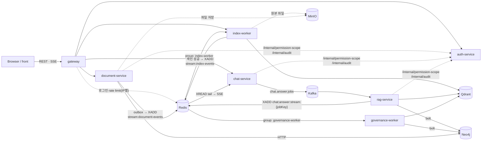
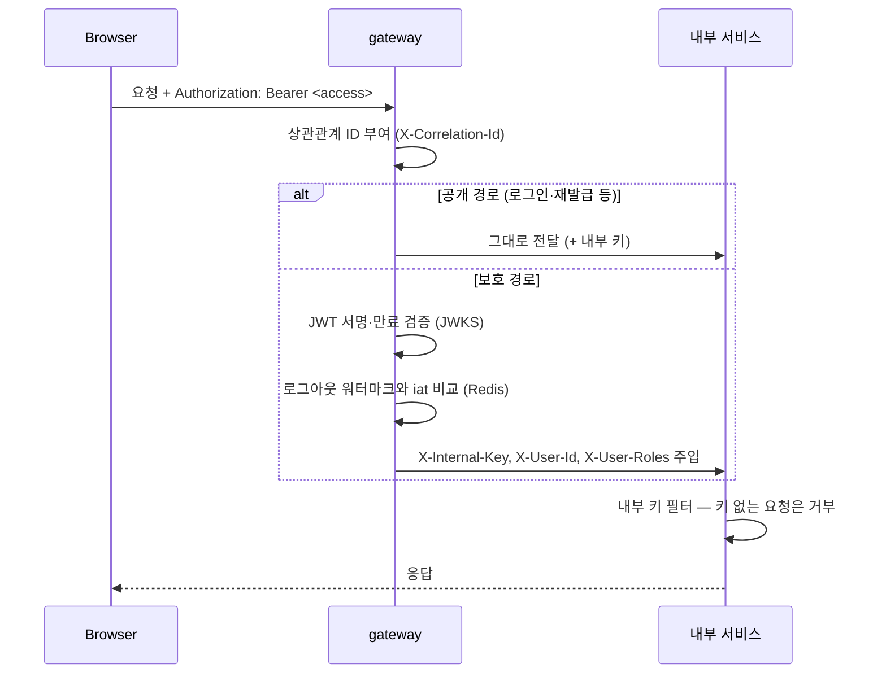
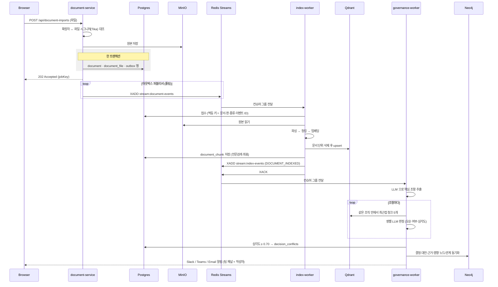
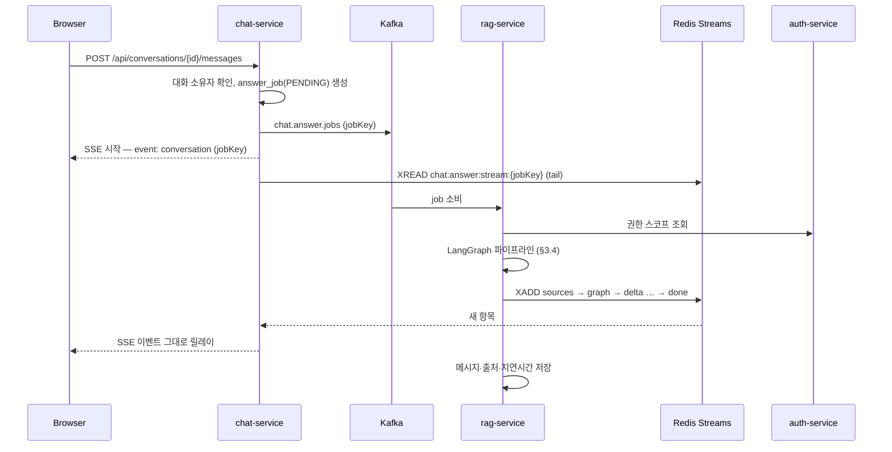
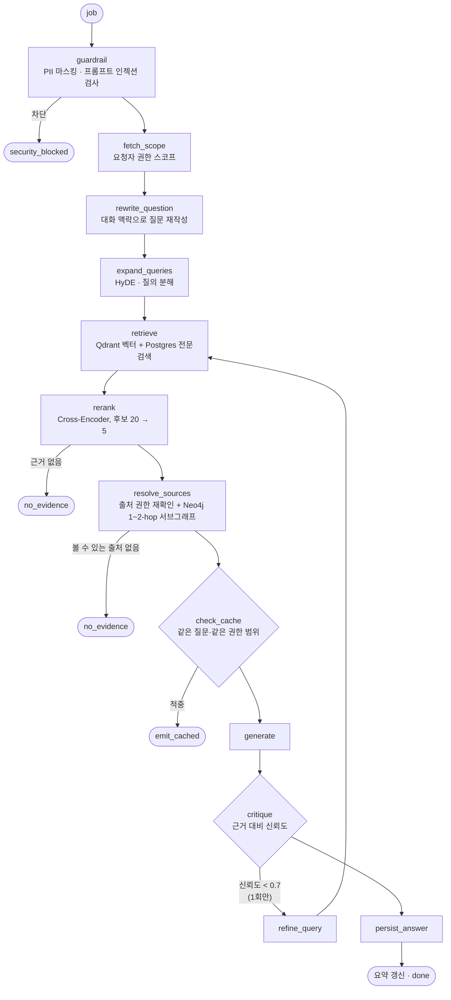
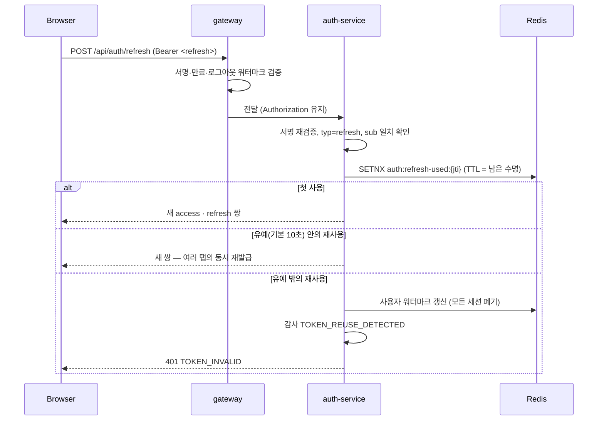
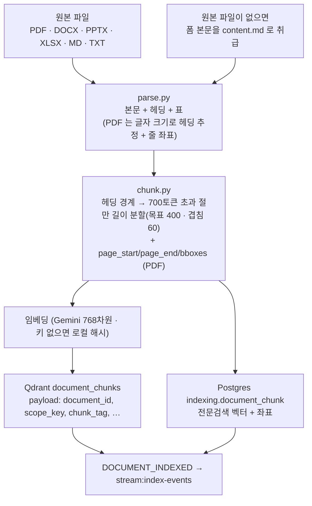

# 아키텍처 및 요청 흐름

서버 구성, 요청이 서비스 사이를 지나가는 경로, 각 설계를 그렇게 한 이유를 정리한다.
서비스 간 데이터 계약의 상세(필드·스키마)는 [`contracts/README.md`](../contracts/README.md)가 원본이고
이 문서는 참조만 한다.

---

## 1. 구성 요소

| 구분 | 모듈 | 스택 | 역할 |
|---|---|---|---|
| Edge | `gateway` | Spring Cloud Gateway (WebFlux) | JWT 검증, 라우팅, 로그인 rate limit, 내부 키·사용자 헤더 주입 |
| Core | `auth-service` | Spring MVC · JPA | 로그인·토큰 발급/회전, 사용자·조직·팀, 접근 정책(`PermissionScope`), 감사 로그, 운영 현황(DLQ 재처리 포함), 제품 지표, 팀별 알림 채널 설정 |
| Core | `document-service` | Spring MVC · JPA · JdbcClient | 문서 CRUD·원본 파일·일괄 가져오기, 아웃박스 발행, 상충 조회/처리, 결정 그래프 조회 |
| Core | `chat-service` | Spring MVC | 대화 CRUD, 답변 job 발행(Kafka), Redis Stream → SSE 릴레이, 출처 재조회, 타임라인 |
| Worker | `index-worker` | Python · FastAPI · asyncpg · pdfplumber | 문서 이벤트 소비 → 파싱·청킹·임베딩 → Qdrant·Postgres 전문검색 저장 → 색인 완료 이벤트 발행 |
| Worker | `governance-worker` | Python · redis-py | 색인 완료 이벤트 소비 → 상충 감지, Neo4j 그래프 동기화, Slack/Teams/Email 알림 |
| Worker | `rag-service` | Python · aiokafka · LangGraph | 답변 생성 파이프라인(가드레일 → 검색 → 재순위화 → GraphRAG → 생성 → 자가비판) |
| Shared | `server/spring/common` | Java 라이브러리 | 에러 응답, 상관관계 ID, 내부 키 필터, PermissionScope·감사 클라이언트, 페이징 |
| Shared | `server/python/shared` (`history_shared`) | Python 라이브러리 | 설정, DB 풀, 임베딩, Qdrant 클라이언트, Redis Stream 컨슈머(XAUTOCLAIM·DLQ), 이벤트 모델, 메트릭, Neo4j 그래프 클라이언트 |
| UI | `front` | React 18 · Vite · TypeScript | 채팅·문서·거버넌스·타임라인·관리자 화면 |
| 저장소 | `postgres` · `redis` · `qdrant` · `minio` · `neo4j` · `kafka` | — | 관계형 DB · 스트림/캐시 · 벡터 · 객체 저장소 · 그래프 · job 큐 |

Postgres 는 인스턴스 하나를 스키마로 나눠 쓴다(auth-service 는 `public`, 나머지는 `document`·`chat`·`indexing`). 서비스는 자기
스키마만 쓰고, 다른 서비스 데이터가 필요하면 API 나 이벤트를 거친다. 예외는 `auth-service` 의 운영
현황·제품 지표로, 집계를 위해 다른 스키마를 **조회 전용**으로 읽는다(쓰기 없음).

---

## 2. 전체 구성도



**메시지 브로커를 둘로 나눈 이유.** 문서 → 색인 → 상충 감지는 순서가 있고 가벼운 상태 전이라
Redis Streams(컨슈머 그룹·XAUTOCLAIM·DLQ)로 충분하다. 답변 생성은 LLM 호출로 오래 걸리고
워커 풀로 부하를 나눠야 해서 Kafka 로 분리했다. 한쪽 적체가 다른 쪽을 막지 않는다.

---

## 3. 요청 흐름

### 3.1 모든 요청의 공통 경로 — 게이트웨이



- 클라이언트가 보낸 `X-User-Id`·`X-User-Roles` 는 **항상 덮어쓴다.** 내부 서비스는 이 헤더를 믿고
  인증을 다시 하지 않으므로, 게이트웨이를 거치지 않은 요청은 내부 키 필터가 막는다.
- 게이트웨이만 호스트에 포트를 연다(127.0.0.1:8080). 나머지 서비스는 도커 네트워크 안에서만 닿는다.
- 게이트웨이의 actuator 는 관리 포트(9090)로 떼어 두고 공개하지 않는다. 인증 필터가 라우트에만
  걸리므로 같은 포트에 두면 `/actuator/gateway`(라우트 표)가 인증 없이 열린다.

### 3.2 문서 등록 → 색인 → 상충 감지



- **아웃박스.** 문서 저장과 이벤트 기록을 같은 트랜잭션에 넣고 퍼블리셔가 따로 발행한다.
  DB 에는 저장됐는데 이벤트가 유실되는 이중 쓰기 문제가 없다.
- **일괄 가져오기는 문서·파일·이벤트를 한 트랜잭션으로 만든다.** 문서를 먼저 만들고 파일을 나중에
  붙이면 색인기가 파일보다 먼저 돌아 본문만으로 색인할 수 있다.
- **상충 감지는 색인이 끝난 뒤에 돈다.** `governance-worker` 가 문서 이벤트가 아니라 색인 완료
  이벤트를 구독하므로 비교할 청크가 반드시 존재한다.
- **상충 감지 비용.** 모든 문서 쌍을 LLM 으로 비교하면 문서 수의 제곱으로 늘어난다. 새 문서에서
  뽑은 조항마다 벡터 최근접 5개만 후보로 삼아 LLM 호출을 `조항 수 × 5` 이하로 묶었다.
- **개정 시 자동 종료.** 문서가 개정되면 재감지가 끝난 뒤 그 문서의 더 낮은 판 기준으로 열려 있던
  상충을 `SUPERSEDED` 로 닫는다. 사람이 처리한 `RESOLVED`·`DISMISSED` 는 건드리지 않는다.

### 3.3 질문 → 답변 스트리밍



- **chat-service 는 생성하지 않는다.** job 을 만들어 Kafka 에 넘기고 Redis Stream 을 꼬리 읽기해
  SSE 로 흘려보내기만 한다. 생성 워커가 죽어도 웹 요청 스레드가 묶이지 않는다.
- **재연결.** 연결이 끊기면 `GET /api/conversations/{id}/jobs/{jobKey}/stream` 에 `Last-Event-ID` 를
  실어 그 이후 항목부터 이어 받는다. job 이 이미 끝났으면 `done`/`error` 한 번만 보낸다.
- SSE 릴레이 스레드 풀은 상한이 있고, 클라이언트가 끊기거나 emitter 가 완료·타임아웃되면 릴레이
  루프가 즉시 끝난다.

### 3.4 답변 파이프라인 (rag-service, LangGraph)



- **권한은 두 번 본다.** 검색 단계에서 스코프로 거르고, 출처를 만들 때 다시 확인한다. 검색 뒤에
  권한이 바뀌었거나 필터를 빠져나간 청크가 답변 근거로 새지 않는다.
- **근거가 없으면 답하지 않는다.** 검색·재순위화 결과가 없거나 볼 수 있는 출처가 없으면 생성 단계로
  가지 않고 `NO_EVIDENCE` 로 끝낸다.
- **답변 캐시 키에 권한 범위가 들어간다.** 같은 질문이라도 볼 수 있는 문서가 다르면 캐시를 공유하지
  않는다.
- 자가비판 재검색은 한 번만 한다. 루프가 무한히 돌며 LLM 비용을 쓰지 않게 막는다.
- LLM 키가 없으면 임베딩은 로컬 해시 임베딩으로, 생성은 근거 발췌로 대체한다.

### 3.5 토큰 재발급 회전



- 토큰은 서버에 목록을 두지 않는 서명 JWT 다. 그래서 로그아웃은 "이 시각 이전에 발급된 토큰은
  전부 무효"라는 **사용자별 워터마크**로 처리하고, 재사용 감지는 "이 토큰이 전에 쓰였나"를 물어야
  해서 **jti 를 낱개로** 기록한다.
- 유예 구간 안에서는 탈취된 토큰도 통과한다. 그 대가를 감수하는 이유는 탭 여러 개의 동시 재발급을
  사고로 판정하면 정상 사용자가 로그아웃되기 때문이다. `JWT_REFRESH_REUSE_GRACE_SECONDS=0` 이면
  엄격 모드가 된다.

---

## 4. 색인 파이프라인



### 4.1 형식별로 얻는 것

| 원본 | 절 구조(`section_path`) | 좌표(`bboxes`) |
|---|---|---|
| `.md` · `.docx` | 헤딩 → 절 경로 | 없음 |
| `.pptx` | 슬라이드 제목 → 절 경로 (제목이 없으면 `슬라이드 N`) | 없음 |
| `.xlsx` | 시트 이름 → 절 경로 | 없음 |
| `.pdf` | 글자 크기로 추정한 헤딩 → 절 경로 | 줄 단위 좌표(0~1 정규화) |

- **표는 마크다운 파이프 행(`| 셀 | 셀 |`)으로 남긴다.** 청커가 이 모양의 줄을 길이 분할에서 끊지
  않으므로 표 한 행이 두 청크로 갈리지 않는다. 머리글 구분선은 붙이지 않는다 — 첫 행이 머리글인지
  파일에서 알 수 없다.
- **PDF 헤딩은 추정이라 보수적으로 잡는다.** 본문 크기(글자 수 최빈값)의 1.15배 이상이고 120자
  이하인 줄을 헤딩으로 보고, 한 크기가 전체 글자의 과반을 차지하지 않으면 추정을 포기한다. 잘못
  자르면 인용이 "문서의 어디"를 틀리게 가리키는데, 그건 구조가 없는 것보다 나쁘다.
- **청크 태그**(`DECISION` · `ACTION_ITEM` · `DISCUSSION` · `BACKGROUND`)는 청크 본문의 낱말로 정한다.
  타임라인 발췌는 `DECISION` 청크만 쓴다.
- **상한.** PDF 500쪽·pptx 300장을 넘으면 거절한다. xlsx 는 행이 많은 것이 정당한 문서일 수 있어
  2,000행까지 읽고 잘랐다는 줄을 본문에 남긴다.
- **원본 파일은 "그 판 이하에서 가장 최근에 올라온 것"을 쓴다.** 본문만 고쳐 판이 올라가도 원본과
  좌표가 유지된다. 원본을 다시 올리면 재색인 이벤트가 나간다.

### 4.2 신뢰성 장치

| 장치 | 막는 것 |
|---|---|
| 컨슈머 그룹 + `XAUTOCLAIM` | 처리 중 죽은 워커가 쥐고 있던 항목이 영원히 대기 목록에 남는 것 |
| `{stream}:dlq` | 전달 한도를 넘긴 항목·계약 위반 항목이 스트림을 막는 것. 운영 화면에서 조회·재처리·폐기 |
| 멱등 키 `evt:{문서}:{판}:{종류}:{이벤트 ID}` | 같은 이벤트의 중복 처리. 이벤트 ID 가 있어 같은 판의 재업로드는 재색인된다 |
| 선점은 짧은 트랜잭션, 파이프라인은 트랜잭션 밖 | 임베딩 속도 제한 대기 동안 행 잠금·DB 연결을 붙잡는 것 |
| 30분 넘은 `RUNNING` 회수 | 워커가 죽어 영원히 `RUNNING` 에 머무는 작업 |
| Qdrant 문서 단위 삭제 후 upsert | 개정으로 청크 수가 줄었을 때 옛 청크가 남는 것 |

---

## 5. 데이터 계약 (`contracts/`)

| 계약 | 생산자 → 소비자 |
|---|---|
| `indexing/README.md` | 색인 규칙(원문 선택·파싱·청킹·태그·토큰 추정) |
| `indexing/golden/` | 파싱·청킹 입출력 스냅샷 — 규칙이 조용히 바뀌는 것을 테스트로 잡는다 |
| `qdrant-chunk-payload.schema.json` | index-worker → rag-service·governance-worker |
| `events/document-events.schema.json` | document-service(아웃박스) → index-worker |
| `events/index-events.schema.json` | index-worker → governance-worker |
| `openapi/<서비스>.yml` | auth/document/chat-service → front |

OpenAPI 스펙은 springdoc 이 뽑고 서비스별 `OpenApiSnapshotTest` 가 커밋된 파일과 비교한다. 로컬에서는
어긋나면 파일을 새로 써서 diff 로 보여주고, CI 에서는 실패시킨다. `/v3/api-docs` 는 내부 키 필터 뒤에
있어 게이트웨이로는 닿지 않는다.

---

## 6. 권한 모델

- **`PermissionScope`** 는 요청자가 볼 수 있는 조직·팀·문서 ID 와 거부 목록이다. `auth-service` 가
  접근 정책으로 계산하고, 문서·채팅·RAG 가 조회 시점마다 받아 쓴다.
- **범위 밖은 없는 것과 같다.** 문서·상충·그래프 조회에서 범위 밖 대상은 404 나 빈 결과로 돌려주고
  "권한 없음"과 구분하지 않는다. 존재 여부 자체가 정보이기 때문이다.
- **그래프 조회는 두 번 거른다.** Postgres 로 시작 문서의 범위를 확인하고 Neo4j 를 1-hop 순회한 뒤,
  순회로 새로 나타난 결정 노드도 다시 범위를 확인해 밖이면 노드·엣지를 지운다.
- **Neo4j 쓰기는 허용 목록으로 제한한다.** LLM 이 문서에서 뽑은 라벨·관계 타입·키 필드를 추출
  단계와 쓰기 단계에서 각각 검증한다. 문서 본문이 쿼리 구조를 바꾸지 못한다.
- **"내 문서"는 `mine=true` 플래그로만 받는다.** 작성자 ID 를 파라미터로 받으면 범위 안에서 특정
  인물의 작성 이력만 골라 훑는 데 쓸 수 있다.
- **관리 범위.** SYSTEM_ADMIN 은 전체, ORG_ADMIN 은 자기 조직, TEAM_ADMIN 은 자기 팀. 역할 변경·
  계정 비활성화·비밀번호 재발급은 자기 상한을 넘는 계정에 쓸 수 없다.
- **세션 종료.** 로그아웃·비밀번호 변경·재발급·계정 비활성화는 모두 사용자 워터마크를 찍어 기존
  세션을 즉시 끊는다.
- **감사.** 거부된 요청은 `DENIED` 로 남긴다. 감사 로그 조회의 **성공**은 남기지 않는다 — 조회할
  때마다 로그가 자기 자신으로 찬다.
- 로그인은 IP 당 초당 1건(버스트 5건)으로 제한한다.

---

## 7. 배포·운영

### 7.1 실행

```bash
docker compose up -d                        # 저장소 6개만 (개발 중 로컬에서 서비스 실행)
docker compose --profile app up -d --wait   # 저장소 + 애플리케이션 전체
```

조직·사용자·정책 시드는 `auth-service` 의 Flyway 시드(dev 프로파일)가 넣고, 문서 시드는
[`deploy/demo-seed/`](../deploy/demo-seed/README.md) 스크립트가 **실제 API 로** 넣는다. 원본 파일이
MinIO 에 들어가고 색인이 돌아야 검색·인용이 되기 때문에 SQL 로 넣지 않는다.

### 7.2 리소스 리밋

모든 서비스에 `deploy.resources.limits` 를 건다.

| 서비스 | cpus | memory |
|---|---|---|
| postgres · qdrant | 1.0 | 512M |
| redis | 0.3 | 128M |
| minio | 0.3 | 256M |
| neo4j | 1.0 | 900M |
| kafka | 1.0 | 1G |
| auth-service · document-service | 0.5 | 640M |
| chat-service · gateway | 0.75 | 640M |
| index-worker | 0.75 | 640M |
| governance-worker | 0.3 | 384M |
| rag-service | 1.0 | 1.5G (재순위화 모델 상주) |
| front | 0.25 | 128M |

### 7.3 메트릭

모든 서비스가 Prometheus 형식으로 메트릭을 낸다.

| 서비스 | 주소 | 내용 |
|---|---|---|
| auth · document · chat | `/actuator/prometheus` | JVM · HikariCP · `http_server_requests_seconds` |
| gateway | `/actuator/prometheus` (관리 포트 9090) | 위와 같음 |
| index-worker | `/actuator/prometheus` (8083) | 스트림 소비 지표 |
| governance-worker · rag-service | 9100 | 스트림 소비 + LLM 호출 + 상충 감지 지표 |

세 워커가 공용 컨슈머를 써서 `stream_messages_total{stream,group,outcome}` ·
`stream_handler_seconds` · `stream_dead_letter_depth` 가 같은 이름으로 나온다.

### 7.4 CI

| 워크플로 | 하는 일 |
|---|---|
| `ci-spring.yml` | `./gradlew build` — 단위·Testcontainers 통합·OpenAPI 스냅샷 테스트 |
| `ci-python.yml` | `ruff check` + shared · index-worker · governance-worker · rag-service 테스트(골든 스냅샷 포함) |
| `ci-front.yml` | 타입 검사 · vitest · 운영 빌드 |
| `ci-images.yml` | `docker buildx bake` 로 바뀐 이미지만 빌드 확인 |

---

## 8. 알려진 한계

- **OOXML 끼리는 형식을 구분하지 못한다.** 파일 시그니처 검사(tika-core)는 zip 안을 열지 않아,
  pptx 를 `.docx` 로 바꿔 올리면 통과한다. 색인 단계에서 명시적으로 실패한다.
- **서식이 균일한 PDF 는 절 구조가 없다.** 글자 크기 차이가 없으면 헤딩을 추정하지 않는다.
- **docx 머리글·바닥글·각주, pptx 발표자 노트는 읽지 않는다.**
- **타임라인의 상충 판정은 캐시가 없을 때 비싸다.** 후보 문서 쌍마다 LLM 을 부른다(최대 30건 →
  435쌍). 판정 결과는 캐시하지만 첫 조회 비용은 남아 있다.
- **dev 환경에서는 auth-service 재시작마다 서명 키가 바뀐다**(`JWT_PRIVATE_KEY` 미설정 시). 게이트웨이의
  JWKS 캐시가 따라가지 못해 재시작이 필요했던 사례가 있다.
